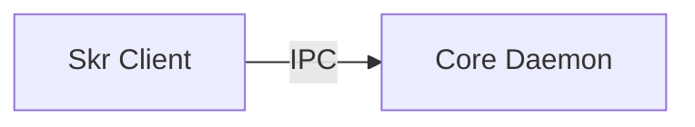

# Logical boundaries

## Boundary breakdown

### On-machine boundaries

- **Skr Client**
  - **Boundary kind:** Unprivileged process.
  - **Logical type:** Package and project client.
  - **Responsibility:** Provides package, build, and project behavior.
  - **Inputs and outputs:** Accepts user requests. Presents plans and results.
  - **Depends on:** Core Daemon through authenticated local IPC.

- **Core Daemon**
  - **Boundary kind:** Privileged process.
  - **Logical type:** Authorization and operation host.
  - **Responsibility:** Authenticates clients and owns operation identity.
  - **Trust boundary:** yes, outer
  - **Inputs and outputs:** Accepts authenticated requests. Emits results and logs.
  - **Depends on:** Nothing inside this repository.

## Domain module boundaries

### Cargo module

- **Boundary kind:** Module inside the daemon.
- **Logical type:** Domain module.
- **Responsibility:** Owns cargo records and their lifecycle.
- **Inputs and outputs:** Receives commands from the Core Daemon. Emits cargo events.
- **Depends on:** Core Daemon.

## Experience Shell

- **Kind:** Client container
- **Type:** Web client shell
- **Responsibility:** Present authenticated workflows.
- **Inputs and outputs:** In: user interaction. Out: authenticated commands.
- **Depends on:** Core Daemon.

## Structure diagram

