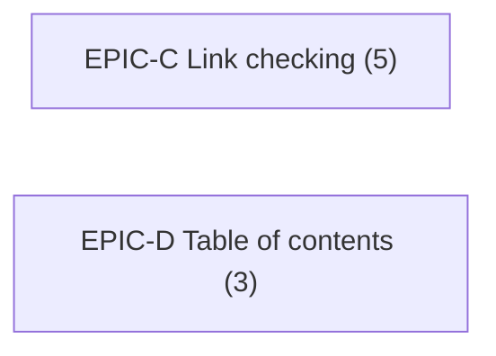

# Critical path

Generated by `constitution-tooling render` from `tasks/epics/`. Do not edit by hand; change the epic files and render again.

## Totals

| Active epics | Open points | Out-of-band epics | Out-of-band points | Waves | Widest wave | Longest chain (points) |
| :--- | :--- | :--- | :--- | :--- | :--- | :--- |
| 2 | 8 | 0 | 0 | 1 | 2 | 5 |

## Longest chain

EPIC-C (5 points). This bounds wall-clock time however many lanes run.

## Waves

An epic joins a wave when every dependency sits in an earlier wave and it is scope-disjoint from every other epic in the wave. A wave of one is a serial segment.

| Wave | Epic | Kind | Open points | Owns | May patch | Depends on |
| :--- | :--- | :--- | :--- | :--- | :--- | :--- |
| 1 | EPIC-C Link checking | product | 5 | `src/core/links.ts`, `src/cli/check.ts`, `tests`, `package.json`, `scripts`, `docs` | `tech-spec/contracts/cli-fix.meta.yaml`, `tech-spec/contracts/check-report.meta.yaml` | — |
| 1 | EPIC-D Table of contents | product | 3 | `src/core/toc.ts` | — | — |

## Build order

An arrow points from a prerequisite to the epic that depends on it, so it reads in the order work flows, the same direction as the longest chain above.

## Ticket order inside each epic

A dependency-respecting listing, not a chain: `needs` names a ticket's own `depends_on` inside its epic, and a ticket without one has no in-epic dependency. Readiness is epic-level: a ticket finished on an unmerged branch satisfies no other epic's dependency until the containing PR merges.

- **EPIC-C:** FIX-C001, FIX-C002 (needs FIX-C001)
- **EPIC-D:** FIX-D001

## Concurrency mechanics

- **Worktree:** ../fixture-cli-epic-<ID>
- **Branch naming:** feat/epic-<id>-<slug>
- **Merge strategy:** rebase
